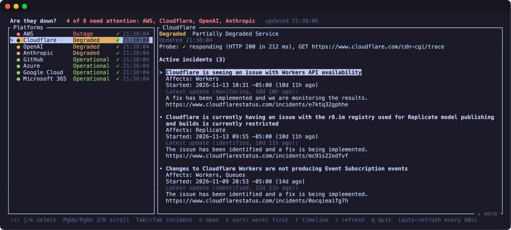

# aretheydown

Is it you, or is it them? aretheydown shows the health of GitHub, AWS, Azure, and other platforms you depend on, on one screen in your terminal.



Run it when something breaks. If a platform you depend on has an incident, you know before you dig into your own systems.

## Install

```bash
brew install reidg44/tap/aretheydown
```

Homebrew builds it from source, so it also installs Rust for the build.

Without Homebrew, build it with Cargo (Rust 1.88 or newer):

```bash
cargo install --git https://github.com/reidg44/aretheydown.git --locked
```

## Use it

Open the interactive screen:

```bash
aretheydown
```

Platforms with trouble come first. Use the arrow keys to pick one, Tab to step through its incidents, `o` to open one in your browser, and `q` to quit. See [all keys and what the screen shows](docs/screen.md).

Check once and print the result, for a quick look or a script:

```bash
aretheydown --once
aretheydown --once --json
```

The exit code is 0 when every platform is Operational, 1 when any isn't, and 2 if aretheydown couldn't run. See [text and JSON output](docs/output.md).

## What it checks

Out of the box:

- GitHub, Cloudflare, AWS, Azure, and Google Cloud
- OpenAI and Anthropic
- Microsoft 365 consumer services, such as Outlook.com and OneDrive

For each one you see the level (Operational, Degraded, Outage, or Unknown), active incidents with the vendor's latest update, and incidents resolved in the last 24 hours.

aretheydown also sends one request to each vendor's own service on every refresh. This [probe](docs/probes.md) can catch trouble the vendor hasn't posted yet.

You can add any vendor that uses Atlassian Statuspage, and checks of your own endpoints. See [Config](#config).

## Keep it running

`--serve` runs aretheydown as a small web server. It checks every platform every 60 seconds.

```bash
aretheydown --serve
```

While it runs, it:

- serves a web page at `http://localhost:7341/` and JSON at `/api/status` ([details](docs/serve.md))
- records a history of every change, so you can look back ([details](docs/history.md))
- posts an alert to a webhook, such as Slack, when a platform's level changes ([details](docs/alerts.md))

To keep it running in the background, start it with Homebrew:

```bash
brew services start aretheydown
```

### Look back in time

"Did that failed deploy line up with an outage?" Ask the history `--serve` recorded:

```bash
aretheydown --at "yesterday 14:05"
aretheydown --at "2h ago"
```

The history also shows in the interactive screen: each platform's last 7 days, and a timeline of all of them when you press `t`. When `--serve` first starts, it fills in recent weeks from the vendors' own incident history. See [History](docs/history.md).

## Config

The config file is optional. It lives at `~/.config/aretheydown/config.toml`.

```toml
# Add a vendor that uses Atlassian Statuspage
[[statuspage]]
name = "Vercel"
url = "https://www.vercel-status.com"

# Check your own endpoint
[[check]]
name = "API"
url = "https://api.example.com/healthz"

# Count only the AWS regions you use
[aws]
regions = ["us-east-1", "us-west-2"]

# Send alerts from --serve
[alerts]
webhook = "https://hooks.slack.com/services/…"
```

You can also hide built-in platforms, watch only some components of a status page, and change probes. See [Config](docs/config.md) and the commented [`config.example.toml`](config.example.toml).

## More documentation

- [The interactive screen](docs/screen.md): keys, history section, and timeline
- [Text and JSON output](docs/output.md): `--once`, JSON fields, levels, and exit codes
- [Web page and JSON API](docs/serve.md): `--serve` and running in the background
- [History](docs/history.md): `--at` and the history file
- [Alerts](docs/alerts.md): webhooks and what an alert looks like
- [Probes](docs/probes.md): what they check and the defaults
- [Config](docs/config.md): every setting and error
- [Development](docs/development.md): building, testing, and releasing

## License

MIT. See [`LICENSE`](LICENSE).
